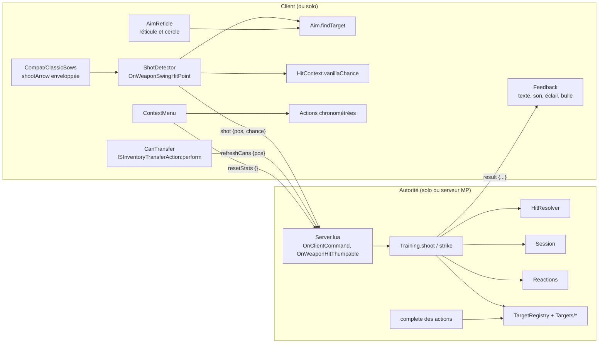

# Architecture

Vue d'ensemble du code de Training Target (version 0.3.0, Build 42.21). Les contrats précis (arguments, clés, valeurs) sont dans [specifications-techniques.md](specifications-techniques.md) ; le comportement vu par le joueur dans [specifications-fonctionnelles.md](specifications-fonctionnelles.md).

## Vue d'ensemble



En solo, les flèches réseau sont des appels directs : `ShotDetector` appelle `Training.shoot`, `BatmanTT.tell` appelle `Feedback.show`.

## Arborescence du mod

```
Contents/mods/
├── batman_TrainingTarget/
│   ├── common/                     ressources communes à la Build 42
│   │   ├── README.txt
│   │   └── media/
│   │       ├── batman_training_01.tiles          propriétés des tuiles
│   │       ├── texturepacks/batman_training_01.pack
│   │       ├── depthmaps/DEPTH_batman_training_01.png
│   │       └── tileGeometry.txt
│   └── 42.21/                      variante chargée (versionMin=42.21)
│       ├── mod.info, icon.png, poster.png
│       └── media/
│           ├── sandbox-options.txt
│           ├── scripts/BatmanTT_items.txt, BatmanTT_recipes.txt, BatmanTT_sounds.txt
│           ├── sound/batman_tt_paper_hit.ogg, batman_tt_can_hit.ogg
│           └── lua/{client,server,shared}/…        (voir ci-dessous)
└── batman_TrainingTargetViewpoint/  mod facultatif (modèles 3D pour Project Viewpoint)
    ├── 42.21/mod.info, icon.png, poster.png
    └── common/media/
        ├── lua/client/TrainingTargetViewpoint.lua
        └── training-viewpoint/training.properties, models/*.obj, *.mtl, palette.png
```

`mod.info` de `batman_TrainingTarget` : `id=batman_TrainingTarget`, `versionMin=42.21`, `modversion=0.3.0`, `pack=batman_training_01`, `tiledef=batman_training_01 7173`. Aucun `require` ni `loadModAfter`.

`mod.info` de `batman_TrainingTargetViewpoint` : `id=batman_TrainingTargetViewpoint`, `require=\batman_TrainingTarget`, `versionMin=42.21`. Il ne contient que du Lua client et des modèles : son script appelle `Viewpoint.ModelPacks.register(modId, "media/training-viewpoint/training.properties")` à `OnGameBoot`, `OnGameStart` et au chargement, et ne fait rien si Project Viewpoint est absent.

## Modules Lua

Chemins relatifs à `Contents/mods/batman_TrainingTarget/42.21/media/lua/`.

### `shared/`

| Fichier | Responsabilité | `require` |
|---|---|---|
| `TrainingTarget/BatmanTT.lua` | Espace de noms global `BatmanTT`, constantes (`NET_MODULE`, `TILESET`, `CONTAINER_TYPE`, `WEAR_KEY`, `FACINGS`, `Zone`, `Outcome`), lecture des options sandbox avec valeurs par défaut, noms et index de sprites, positions `"x,y,z"`, distance, clé de séance. | — |
| `TrainingTarget/TargetRegistry.lua` | Registre des types de cible (`registerTarget`, `targetOf`, `findTargetOnSquare`), état (usure, trous) dans `movableData`, calques `attachedAnimSprite`, `syncObject`, `restoreTarget` après une pose. | BatmanTT |
| `TrainingTarget/Placement.lua` | Enveloppe de `ISMoveableSpriteProps:placeMoveableInternal` : après chaque pose, l'autorité reconstruit la cible (calques, sprite d'usure) d'après son état. | TargetRegistry |
| `TrainingTarget/Targets/SheetTarget.lua` | Fabrique des cibles à feuille : usure, trou dans la zone touchée, remplacement de la feuille, côté du mur. | TargetRegistry |
| `TrainingTarget/Targets/SheetTargets.lua` | Enregistre `paper`, `stand` et `vanilla`. | SheetTarget |
| `TrainingTarget/Targets/CanStand.lua` | Support à conserves : `AcceptItemFunction` du conteneur, calques par conserve, retrait d'une conserve touchée ; s'abonne à `LoadGridsquare` et `OnObjectAdded` pour reposer la restriction du conteneur. | TargetRegistry |
| `TrainingTarget/Targets/Dummy.lua` | Mannequin : usure selon l'arme, quatre états de sprite, réparation. | TargetRegistry |
| `TrainingTarget/HitResolver.lua` | Fonctions pures : chance vanilla d'un tir (portage de `CombatManager.calculateHitChanceData`), chance d'entraînement, couleur du cercle de visée, zone touchée, XP, précision. | BatmanTT |
| `TrainingTarget/HitContext.lua` | Relève sur le tireur, l'arme, la case visée et le climat les valeurs passées à `HitResolver`. | HitResolver |
| `TrainingTarget/Session.lua` | Statistiques de séance par joueur, en mémoire de l'autorité, avec expiration. | BatmanTT |
| `TrainingTarget/Reactions.lua` | Choix pur d'une réaction (centres d'affilée, record, série perdue). | BatmanTT |
| `TrainingTarget/Training.lua` | Service de l'autorité : `shoot`, `strike`, `canShoot`, `meleePerk`, statistiques ; `BatmanTT.tell` (retour au joueur). | BatmanTT, HitResolver, HitContext, Session, Reactions, TargetRegistry |
| `TrainingTarget/Maintenance.lua` | Fournitures d'entretien, portée, résolution des objets en MP, consommation. | TargetRegistry |
| `TimedActions/BatmanTT_ReplaceSheetAction.lua` | Action « Changer la feuille » (100 unités de temps). | (Maintenance chargé par ContextMenu) |
| `TimedActions/BatmanTT_RepairDummyAction.lua` | Action « Réparer le mannequin » (300 unités, son `Hammering`). | idem |
| `Translate/<LANGUE>/*.json` | Traductions (10 langues). | — |

### `client/`

| Fichier | Responsabilité |
|---|---|
| `TrainingTarget/Aim.lua` | Cible visée : silhouette sous le curseur de la souris, sinon case d'attaque du moteur ; à la manette, première cible dans l'axe du regard sans traverser mur ni porte. `isValidShot` pour le réticule. |
| `TrainingTarget/ShotDetector.lua` | Abonné à `OnWeaponSwingHitPoint` : cherche la cible, calcule la chance vanilla, envoie `shot` (MP) ou appelle `Training.shoot` (solo). |
| `TrainingTarget/AimReticle.lua` | Élément d'interface ajouté à `OnGameStart` : redessine le cercle de visée coloré et le réticule « cible valide » sur une cible d'entraînement. |
| `TrainingTarget/Feedback.lua` | Affiche les résultats (textes flottants `HaloTextHelper`, son d'impact sur un émetteur libre, éclair sur le mannequin, phrase `player:Say`), garde la dernière séance reçue ; abonné à `OnServerCommand`. |
| `TrainingTarget/ContextMenu.lua` | Sous-menu « Cible d'entraînement » (`OnFillWorldObjectContextMenu`) : état, entretien, statistiques, nouvelle séance. |
| `TrainingTarget/CanTransfer.lua` | Enveloppe `ISInventoryTransferAction:perform` pour recompter les conserves après tout transfert vers ou depuis un support. |
| `TrainingTarget/Compat/ClassicBows.lua` | Enveloppe `MandelaBowAndArrow.Client.shootArrow` à `OnGameStart` (arcs de [SVRP] ClassicBows) et juge chaque flèche comme un tir. |

### `server/`

| Fichier | Responsabilité |
|---|---|
| `TrainingTarget/Server.lua` | Autorité : `OnWeaponHitThumpable` (solo et serveur) et `OnClientCommand` (serveur seulement) pour `shot`, `refreshCans`, `resetStats` ; contrôles anti-abus des tirs ; recomptage différé des conserves par `OnTick` temporaire. Sort immédiatement sur un client MP (`isClient()`). |

## Flux de données

### Tir d'arme à feu

1. Le moteur déclenche `OnWeaponSwingHitPoint` sur la machine du tireur pour chaque tir (en MP, le serveur ne le reçoit que si un personnage est touché).
2. `ShotDetector.onShot` vérifie un joueur local et une arme `isAimedFirearm`, appelle `Aim.findTarget`, puis `HitContext.vanillaChance` : la chance est calculée chez le tireur, comme le moteur le fait pour un zombie (temps de visée et lumière connus de cette machine seulement).
3. MP : `sendClientCommand(player, "BatmanTT", "shot", { pos, chance })`. Le serveur (`Commands.shot`) applique la cadence, retrouve la cible de la case, le plafond par minute, puis appelle `Training.shoot`.
4. `Training.shoot` revérifie arme, étage, portée, côté, orientation du tireur (écart ≤ 60°) et ligne de vue `LosUtil.lineClear` de la case de la cible vers le tireur (`canShoot`, partagé : même jugement en solo, sur le serveur et pour le réticule), la distance minimale et l'état de la cible, calcule la chance d'entraînement, tire `ZombRand(100) <= chance`, tire la zone, met à jour la séance, applique le coup (`applyHit`), synchronise l'objet, donne l'XP de Visée par `addXp`.
5. `BatmanTT.tell` renvoie le résultat : `sendServerCommand(player, "BatmanTT", "result", result)` en MP (avec `playerOnlineId` pour l'écran partagé), appel direct de `Feedback.show` en solo.

En solo, la cadence et le plafond par minute ne sont pas contrôlés (ils sont dans `Server.lua`).

### Coup de mêlée

`OnWeaponHitThumpable` n'est déclenché que sur l'autorité, juste avant les dégâts vanilla. `Server.lua` reconnaît la cible et appelle `Training.strike`, qui remonte d'abord la santé de l'objet au-dessus de son maximum de `getDoorDamage()` (le meuble d'entraînement ne casse pas sous les coups d'un joueur), puis, si la cible est de mêlée et l'option `MeleeTraining` active, use le mannequin et donne l'XP de la compétence de l'arme.

### Entretien

Le menu contextuel ajoute les actions chronométrées partagées. En MP, le serveur exécute `complete()` (il n'appelle jamais `isValid`), qui revalide tout par les mêmes fonctions (`validate`), consomme les fournitures (`Maintenance.consume` → `sendRemoveItemFromContainer`), réinitialise la cible et la synchronise.

Le remplissage du support utilise les transferts vanilla (`ISInventoryTransferAction`) ; `CanTransfer.lua` envoie ensuite `refreshCans`, traité aussitôt (limité à un par 250 ms) puis de nouveau une seconde plus tard, pour rattraper les transactions Java encore en cours.

### Synchronisation

`BatmanTT.syncObject` (serveur seulement) appelle `transmitModData()` et, si un sprite ou un calque a changé, `transmitUpdatedSpriteToClients()`. Le son d'impact est joué par le client du tireur sur un émetteur libre que le moteur relaie aux joueurs proches.

## Persistance

| Donnée | Support | Durée de vie |
|---|---|---|
| Usure et trous d'une cible (`movableData.batmanTT`) | ModData de l'objet du monde | Sauvegardés avec l'objet ; suivent la cible ramassée dans l'objet d'inventaire. |
| Trous et conserves dessinés | Calques `attachedAnimSprite` de l'objet | Sauvegardés avec l'objet ; redessinés après une pose d'après l'état. Les conserves sont recomptées depuis le conteneur. |
| État du mannequin | Sprite de l'objet (index 12 à 27) | Sauvegardé avec l'objet. |
| Conserves | Conteneur `batmanTTCans` de l'objet | Sauvegardé par le moteur ; la restriction `AcceptItemFunction`, non sauvegardée, est reposée à `LoadGridsquare` et `OnObjectAdded`. |
| Statistiques de séance | Table Lua en mémoire de l'autorité (`Session`) ; dernière copie reçue côté client (`Feedback`) | Perdues au redémarrage du serveur ou à la fermeture de la partie solo ; expirent après `SessionTimeout` minutes réelles sans tir. |

Aucune ModData globale, aucun fichier, aucune migration de schéma.

## Points d'extension et intégrations

- **Nouveau type de cible** : un fichier `shared/TrainingTarget/Targets/<Nom>.lua` qui appelle `BatmanTT.registerTarget{...}` (champs décrits dans [specifications-techniques.md](specifications-techniques.md#registre-des-cibles)). Le premier type dont `match` reconnaît le sprite l'emporte.
- **Arme qui tire sans l'attaque vanilla** : appeler `BatmanTT.ShotDetector.onShot(player, weapon)` après chaque tir (modèle : `Compat/ClassicBows.lua`).
- **Cibles vanilla** : `location_military_generic_01_68` à `_71` sont reconnues sans calques d'impact (option `VanillaTargets`).
- **Project Viewpoint** : modèles 3D fournis par le mod séparé `batman_TrainingTargetViewpoint`.
- **[SVRP] ClassicBows** (`SVRPClassicBows`) : compatibilité facultative, active seulement si `MandelaBowAndArrow.Client.shootArrow` existe.

## Outillage

- `tests/run_tests.py` : luacheck (`.luacheckrc`), syntaxe Lua 5.1, absence de `next()`, traductions (clés et paramètres identiques à EN), descriptions Steam (8 000 octets, BBCode, cohérence avec `workshop.txt`), tests Lua `tests/lua/test_*.lua` sous `lupa` avec l'API du jeu simulée (`tests/lua/helpers/world.lua`, `tests/lua_harness.py`).
- CI : `.github/workflows/checks.yml` (Ubuntu, Python 3.12, `lua-check`, `lupa`) lance `python tests/run_tests.py --require-luacheck`.
- `source/training_targets/build_training_targets.py` : recette Blender des tuiles (nécessite `pz-sprite-forge`, variable `PZ_FORGE`) ; contrat des index : [annexes/conception/assets-spec.md](annexes/conception/assets-spec.md).
- `source/viewpoint/export_viewpoint.py` : export des modèles Project Viewpoint depuis la même géométrie.
- Protocole de test en jeu : [annexes/tests/test-protocol.md](annexes/tests/test-protocol.md).
