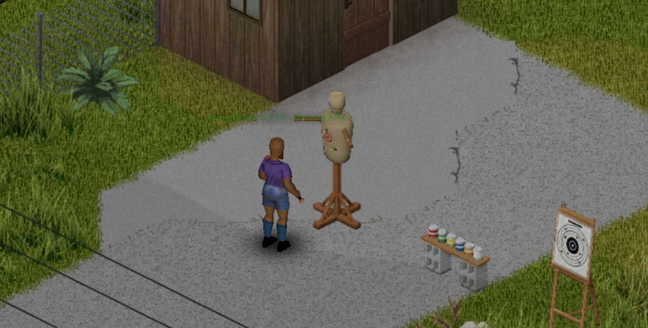

# Spécifications fonctionnelles

Comportement de Training Target 0.3.0 (Build 42.21) du point de vue du joueur et de l'administrateur. Les valeurs exactes (types, clés, index) sont dans [specifications-techniques.md](specifications-techniques.md).

## Objets et fabrication

### F01 — Quatre meubles d'entraînement

| Objet | Pose | Usage |
|---|---|---|
| Cible papier | Sur un mur nord ou ouest (2 orientations) | Tir ; zones et trous ; tir seulement du côté de la face. |
| Cible sur pied | Au sol, 4 orientations | Tir ; zones et trous ; un peu plus difficile (−5 % de chance), XP × 1,25. |
| Support à conserves | Au sol, 4 orientations | Tir sur jusqu'à 6 conserves vides ; plus difficile (−15 %), XP × 1,5, sans zones. |
| Mannequin d'entraînement | Au sol, 4 orientations | Mêlée ; s'use, quatre états visibles, se répare. |

Ce sont des meubles déplaçables vanilla : ils se ramassent, se déplacent et se démontent comme les autres.

### F02 — Recettes de menuiserie

Catégorie *Menuiserie*, sur n'importe quelle surface. Marteau, scie et outil d'écriture sont gardés.

| Recette | Ingrédients | Temps | XP Menuiserie |
|---|---|---|---|
| Fabriquer une cible papier | marteau, stylo/crayon/marqueur, 1 planche, 2 clous, 1 papier | 150 | 5 |
| Fabriquer une cible sur pied | marteau, scie, stylo/crayon/marqueur, 3 planches, 4 clous, 1 papier | 300 | 10 |
| Fabriquer un support à conserves | marteau, scie, 3 planches, 4 clous | 250 | 10 |
| Fabriquer un mannequin d'entraînement | marteau, scie, 4 planches, 6 clous, 1 drap, 10 touffes de foin ou d'herbe ou chiffons | 400 | 15 |

Papiers acceptés : feuille, papier millimétré, brochure, prospectus, documents, lettre manuscrite, gribouillis, dessin d'enfant, courrier.

## Tir

### F03 — Tir sur une cible

Arme à feu visée en main, le joueur tire sur une cible d'entraînement. Le tir compte si :
- la cible est au même étage, à portée de l'arme (plus une marge d'une case et demie) ;
- le tireur est à au moins `MinShootingDistance` cases (sinon « Je suis trop près de la cible ») ;
- pour une cible murale, le tireur est devant la face ;
- la cible est utilisable (feuille non criblée, conserves présentes).

À la souris, la cible est celle dont la silhouette est sous le curseur ; à la manette, la première cible dans l'axe du regard, sans traverser mur ni porte.

### F04 — Chance de toucher identique à celle contre un zombie

La chance reprend le calcul vanilla d'un tir sur une cible immobile : précision de l'arme, niveau de Visée, temps de visée, portée du viseur, déplacement, trait Tireur d'élite, douleur aux bras, vent, pluie, brouillard et obscurité, moodles (panique, stress, fatigue, endurance, ivresse), couvre-chef, bout portant. S'ajoutent le modificateur de la cible (F01) et l'option `HitChanceBonus`. Résultat borné entre 5 et 100 %.

### F05 — Zones de précision et trous

Sur une cible à feuille, un tir réussi tombe dans le centre, l'anneau intérieur ou l'anneau extérieur :

| Visée | Centre | Anneau intérieur | Anneau extérieur |
|---|---|---|---|
| Niveau 0 | 10 % | 30 % | 60 % |
| Niveau 10 | 35 % | 40 % | 25 % |

Un trou est dessiné dans la zone touchée (4 emplacements par zone) sur la cible papier et la cible sur pied. Les cibles militaires vanilla n'ont pas de trous.

### F06 — Réticule et cercle de visée

En visant une cible où le tir compterait, le réticule « cible valide » s'affiche dans la couleur « cible » des options, comme sur un zombie. À la souris, le cercle de visée passe du rouge au vert selon la chance réelle. L'écart des branches du réticule reste celui du moteur. Chaque élément respecte les options d'affichage du jeu.

### F07 — Conserves

Le support accepte seulement des conserves vides, jusqu'à `MaxCans`. Chaque conserve est visible sur la planche. Une conserve touchée tombe et disparaît. Support vide : « Il n'y a plus de conserves sur le support ».

### F08 — Retour au joueur

Après chaque tir compté : texte flottant « Dans le mille ! », « Anneau intérieur », « Anneau extérieur » ou « Raté », ligne de statistiques (`touchés/tirs - précision - série`), son d'impact (papier ou conserve) entendu par les joueurs proches.

## Mêlée

### F09 — Mannequin d'entraînement

Chaque coup d'une arme de mêlée catégorisée (hache, lame longue, lance, petite lame, petit contondant, contondant) donne `MeleeXpPerHit` XP dans la compétence de l'arme. Les mains nues et les armes sans catégorie n'entraînent rien. Le mannequin clignote brièvement en rouge et un texte affiche la compétence, l'XP et l'état restant (« Hache +1.5 XP - mannequin 88 % »).

### F10 — Usure du mannequin

Un coup use le mannequin selon l'arme : un coup de batte de baseball compte 1, un couteau 0,2, une hache ou une masse 3. `DummyDurability` se compte donc en coups de batte. Le sprite change aux tiers de l'usure (intact, usé, très usé), puis le mannequin est « en lambeaux » et n'entraîne plus jusqu'à sa réparation. Les coups de joueur ne cassent jamais un meuble d'entraînement.

## Entretien

### F11 — Menu « Cible d'entraînement »

Clic droit sur une cible (ou sur un autre objet de sa case) : sous-menu avec l'état de la cible (feuille `n/max`, conserves `n/max`, état du mannequin en %), l'action d'entretien, et pour les cibles de tir les statistiques et une nouvelle séance. Une option sans fournitures reste visible, grisée, avec une infobulle qui liste ce qui manque.

### F12 — Changer la feuille

Feuille de papier (consommée) et stylo, crayon ou marqueur (gardé), à côté de la cible. Efface l'usure et les trous. Fonctionne aussi sur les cibles vanilla.

### F13 — Réparer le mannequin

Marteau en main, 1 planche et 2 clous (consommés). Remet le mannequin à 100 % et à son sprite intact ; +3 XP Menuiserie.

### F14 — Remettre des conserves

Transfère les conserves vides de l'inventaire vers le support, dans la limite des places libres. Les conserves peuvent aussi être glissées à la main dans le conteneur du support ; tout autre objet est refusé.

## Séance de tir

### F15 — Statistiques

Tirs, touchés, précision, centres, série en cours et meilleure série, par joueur. Une séance se termine après `SessionTimeout` minutes réelles sans tir (0 : jamais) ou par « Commencer une nouvelle séance ». Les statistiques ne sont pas sauvegardées.

### F16 — Réactions du personnage

Le personnage dit une phrase (bulle locale, dans la langue du joueur) après 3 centres d'affilée (puis 6, 9…), quand sa série dépasse une meilleure série d'au moins 3 (une fois par série), ou quand un raté casse une série d'au moins 5 touchés. Une seule réaction par tir ; le record passe avant les centres.

## Compatibilités

### F17 — Cibles militaires vanilla

Les cibles « Silhouette » et « Circulaire » posées sur un mur (`location_military_generic_01_68` à `_71`) servent à l'entraînement au tir si `VanillaTargets` est actif, sans trous dessinés.

### F18 — Arcs de [SVRP] ClassicBows

Les flèches des arcs et arbalètes de ce mod sont jugées comme des tirs d'arme à feu (chance, zones, statistiques, XP de Visée). Le vol de la flèche n'est pas suivi.

### F19 — Modèles Project Viewpoint

Le mod facultatif *Training Target - Viewpoint models* fournit les modèles 3D des quatre meubles, des quatre états du mannequin, des trous et des conserves pour Project Viewpoint. Sans Project Viewpoint, il ne fait rien.

## Options sandbox (page « Training Target »)

| Option | Défaut | Effet |
|---|---|---|
| XP de Visée par touche (`AimingXpPerHit`) | 2,0 | XP de base d'un tir réussi, multipliée par la cible (support × 1,5, cible sur pied × 1,25) et la zone (centre × 1,5, anneau intérieur × 1,25). |
| XP de mêlée par coup (`MeleeXpPerHit`) | 1,5 | XP de compétence d'arme par coup sur le mannequin. |
| Distance de tir minimale (`MinShootingDistance`) | 3 | En dessous, le tir ne compte pas. |
| Bonus de chance de toucher (`HitChanceBonus`) | 0 | Points de pourcentage ajoutés (−50 à +50). |
| Solidité de la feuille-cible (`SheetDurability`) | 30 | Touchés avant de changer la feuille. |
| Solidité du mannequin (`DummyDurability`) | 150 | Coups de batte avant réparation. |
| Conserves sur le support (`MaxCans`) | 6 | Capacité du support (1 à 6). |
| Entraînement à la mêlée (`MeleeTraining`) | oui | Le mannequin donne de l'XP. |
| Cibles du jeu (`VanillaTargets`) | oui | Cibles militaires vanilla utilisables. |
| Fin de séance (`SessionTimeout`) | 10 | Minutes réelles sans tir avant la fin d'une séance (0 : jamais). |

L'XP passe par `addXp` : la courbe de niveaux, les livres de compétence et les traits vanilla s'appliquent ensuite.

## Solo et multijoueur

- **Solo** : tout est décidé localement.
- **Multijoueur** : le serveur décide de chaque tir, coup, entretien et recomptage. La chance de toucher vient du client du tireur (comme pour un zombie) ; le serveur la borne et contrôle arme, cible, portée, côté, orientation, ligne de vue, cadence (un tir par 100 ms) et 120 tirs comptés par minute. Les résultats et les réactions ne s'affichent que chez le tireur ; trous, conserves, état du mannequin et sons sont vus par tous. L'écran partagé est pris en charge.

## Limites connues

- Les munitions ne sont pas contrôlées par le serveur, et la chance envoyée par le client n'est que bornée.
- En solo, la cadence et le plafond de tirs par minute ne sont pas contrôlés (arme, étage, portée, côté, orientation du tireur et ligne de vue le sont, comme en MP).
- Les statistiques de séance sont perdues au redémarrage du serveur ou en quittant la partie.
- L'écart des branches du réticule n'est pas modifiable depuis Lua : il reste réglé sur la portée maximale du viseur.
- Les flèches de ClassicBows sont jugées au moment du tir, sans suivre leur trajectoire.
- Validation en jeu : voir [annexes/tests/test-protocol.md](annexes/tests/test-protocol.md) pour les points encore à confirmer.
