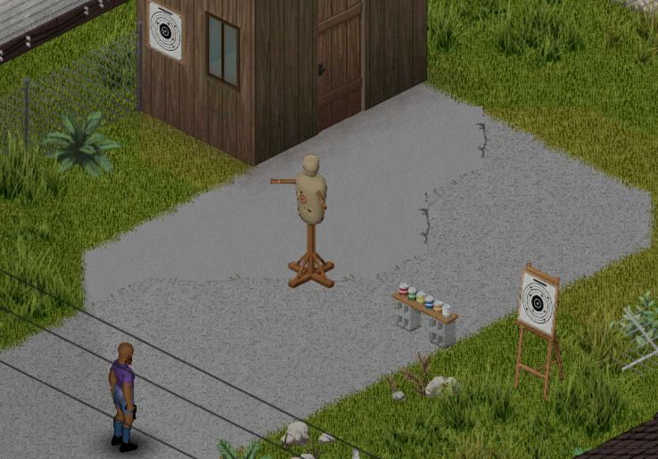

# Training Target

Build a shooting range in your base: a wall paper target, a target stand, a can stand and a melee training dummy. Train Aiming and your melee skills safely, in singleplayer and multiplayer (Project Zomboid Build 42.21).

## Pages

1. [Installation](01-installation.md)
2. [Placing and using targets](02-placing-and-using-targets.md)
3. [Experience gained](03-experience.md)
4. [Sandbox options](04-sandbox-options.md)
5. [Multiplayer](05-multiplayer.md)
6. [FAQ](06-faq.md)

## At a glance

- Four pieces of furniture, crafted with Carpentry.
- Your chance to hit follows the game's own firearm rules, as on a zombie.
- Bullseye, inner ring and outer ring, with holes drawn where you hit.
- Fixed experience per hit: the game's XP curve, skill books and traits do the rest.
- Session statistics, character reactions, maintenance, vanilla military targets, gamepad support.

[Version française](../fr/Home.md)
